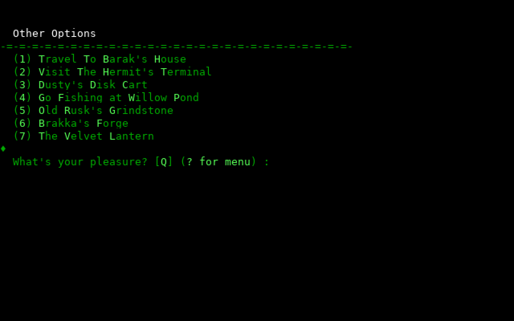
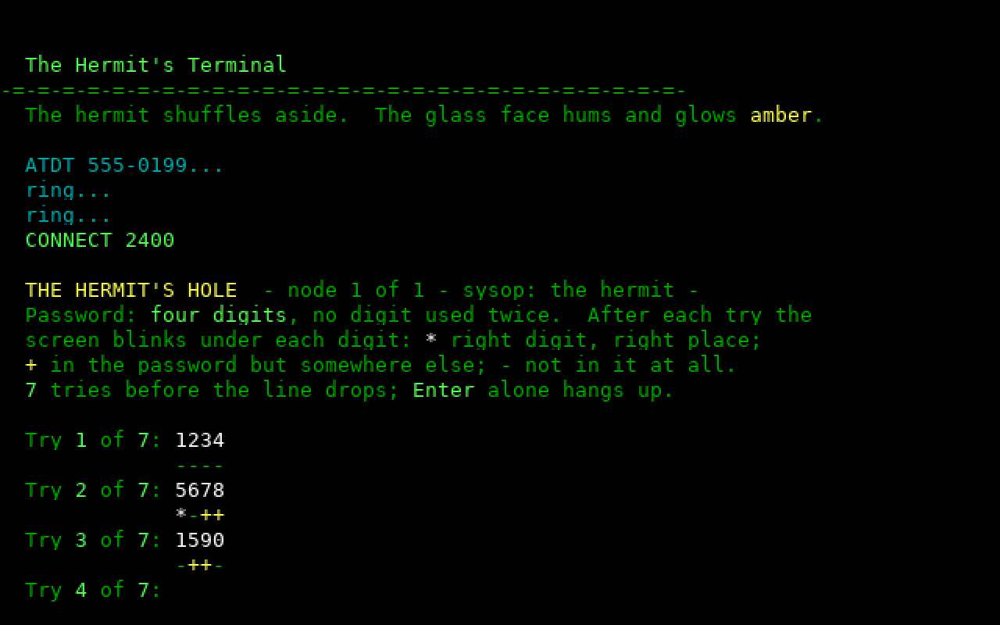
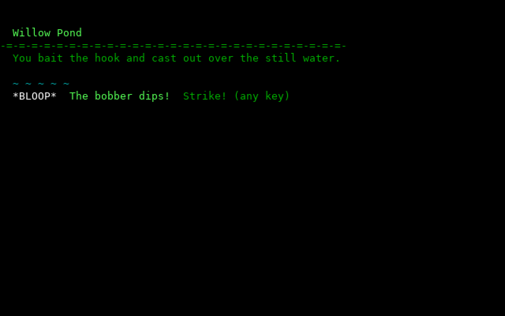
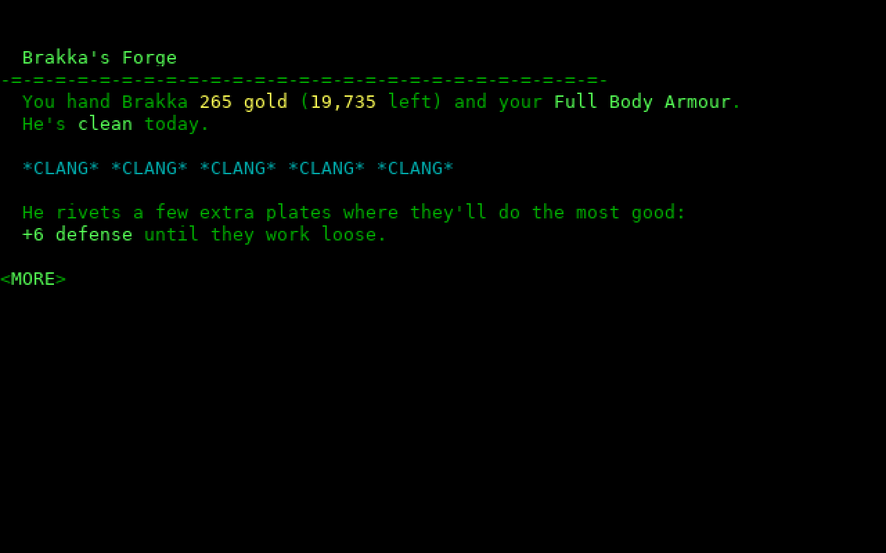
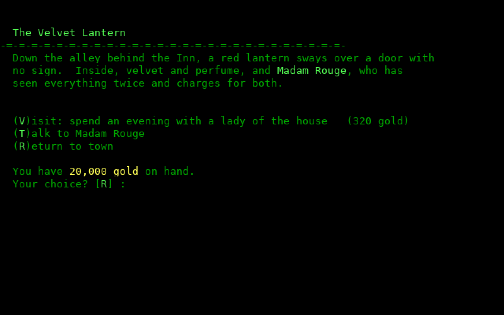

# lord-igms

In-game modules (IGMs) for **Legend of the Red Dragon**, written in
Python, for [flux/bbs](https://github.com/phrac/fluxbbs) boards. They're
the places LORD lists under **Other Places**, like the DOS IGMs of the
'90s (Barak's House and the rest), but they run on the board's host
rather than in its DOS machine, so they can keep shared state, use
timing, and be changed without a rebuild.

They were written for [disflux](https://disfluxbbs.com) and play there.

| | |
|---|---|
|  |  |
|  |  |
|  | |

## The places

| Module | What it is |
|---|---|
| `terminal.py` | **The Hermit's Terminal.** An old hermit's terminal still dials out. Once a day, crack his board's four-digit password in seven tries (a mark under each digit: `*` right place, `+` elsewhere, `-` not in it) for gems, gold and experience; fail and it's a headache. |
| `dusty.py` | **Dusty's Disk Cart.** Unlabeled floppies, three a day: a shareware game, a lost bank file, a gem, a love poem, a strategy guide, a blank disk, "Abort, Retry, Fail?", or a virus with its effect on the screen (Cascade, Ping-Pong, Stoned, Michelangelo). Leave a floppy with a note for a later buyer. |
| `pond.py` | **Willow Pond.** Five casts a day: strike when the bobber dips, work the big ones' runs and pulls with the right key in time, sell to Gert by the pound. A shared book of records, and Old Whiskers, the legendary catfish. |
| `grind.py` | **Old Rusk's Grindstone.** Weapon sharpening by a drunk. Sober, a small sure edge; plastered, anything: blunted or chipped blades, a brawl, a picked pocket, now and then a drunken masterwork. Buy him an ale (or a coffee) for whoever's next. |
| `forge.py` | **Brakka's Forge.** Armor, the other way round: Brakka works on dragon scale, and the higher he is, the better the work, up to dragonforged plate (soaring, he may hide from dragons only he can see). |
| `lantern.py` | **The Velvet Lantern.** Madam Rouge's house behind the Inn. Violet (Seth Able, for a woman) likes someone with a little experience, but not a regular: two visits a week help, a third gets the town talking, more and she hears about it. With LORD's clean mode on, it's a dance hall. |

**Fairies** (`fairies.py`) tie them together: a jar each player carries.
One comes up on a line at Willow Pond now and then; spent, she whispers
a digit at the Hermit's Terminal, sniffs a virus off one of Dusty's
floppies, steadies Rusk's wheel, coaxes Brakka's best work, or keeps a
lookout at the Velvet Lantern. LORD's own fairy, from the forest, stays
LORD's: modules can see it (Brakka works better with one about) but not
take it.

Weapon edges and armor plating are strength and defense added for the
day: they come off at the player's next visit on a later day, or with
another weapon or armor, so selling and buying again can't farm them.

## Installing

Needs [flux/bbs](https://github.com/phrac/fluxbbs) with LORD running in
its DOS machine ([setting up LORD](https://github.com/phrac/fluxbbs/blob/master/docs/DOORS.md#legend-of-the-red-dragon-lord)),
its `[dos.native]` hookup ([in-game modules](https://github.com/phrac/fluxbbs/blob/master/docs/DOORS.md#in-game-modules-igms)),
and Python 3 (in the flux/bbs Docker image already).

1. Put this repository where the board can read it, outside the DOS
   drive (so DOS programs can't write scripts the board would run):

       git clone https://github.com/phrac/lord-igms.git doors/igm

2. Point `[dos.native]` at it in `fluxbbs.toml`: any `NAME.py` there is
   then the program `NAME`, looked for on each visit, so new modules and
   changes are live at once.

   ```toml
   [dos.native]
   "*" = "doors/igm"
   ```

   (A relative path is from the board's scripts folder; give a whole
   path to be sure, e.g. `/srv/board/doors/igm` in the Docker image.)

3. Add each module you want to LORD's Other Places:

       python3 doors/igm/pond.py install doors/dos/LORD

   That adds its two lines to `3RDPARTY.DAT` and puts `POND.IGM` beside
   it (LORD only sends players to a program it can find; the board runs
   the script in its place). `uninstall` takes them off again.

Each keeps its state in a `.DAT` file in LORD's folder (`POND.DAT`,
`FAIRIES.DAT`...), as JSON. To reset a module's day, delete its file
(records and all) or edit it.

## Writing one

A module is a script and `lordigm`:

```python
import lordigm

with lordigm.Igm() as g:
    g.title("The Well")
    g.say("  `2A deep well.  You hear something down there.")
    if g.key("  `2Drop in a coin? [`0Y`2/`0N`2] : ", "YN", "N") == "Y":
        g.player.gold -= 1
        g.player.charm += 1
        g.say("  `2You feel lucky.  `0+1 charm`2.")
    g.more()
```

`lordigm` loads the player's record (LORD's own PLAYER.DAT, 236 bytes,
the same in 3.x and 4.x; fields by their LORDSTRC.PAS names) and saves
it on the way out, gives LORD back the time used, turns LORD's color
codes into ANSI, reads keys (`key`, `ask`, `getkey`, `more`), writes to
the Daily Happenings (`news`) and mail, and cleans what players type with
LORD's BADWORDS.DAT. A caller who hangs up ends the module with the
record saved. Copy an `install` from one of the modules for yours.

Keep dark grey (`` `8 ``) for what may go unseen: some terminals draw it
black.

## License

MIT, like [flux/bbs](https://github.com/phrac/fluxbbs). LORD is Seth
Able Robinson's (and Metropolis' since 4.0): these only add to it.
